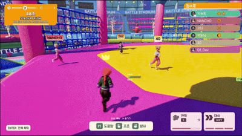
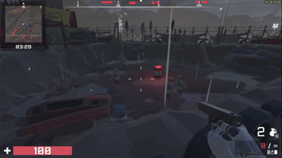
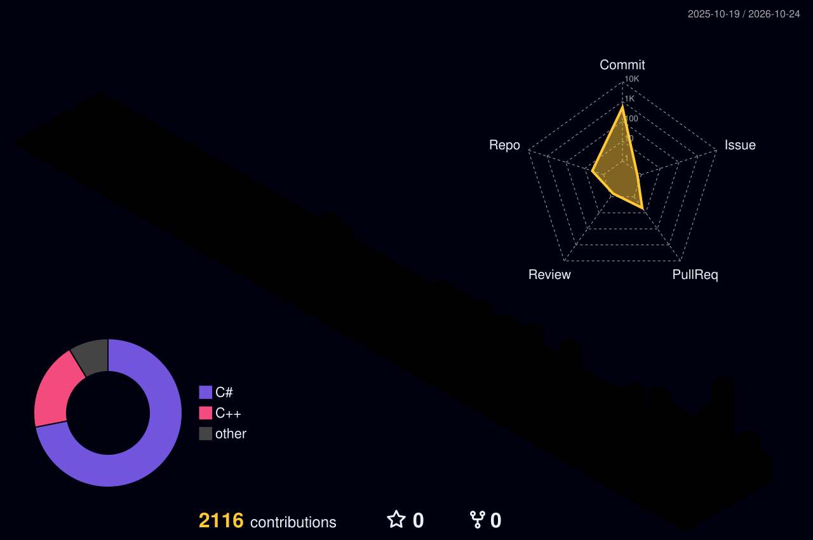

# Hi there, I'm Q1-Build.

> "Eat. Code. Build Games. Repeat."

Unity game developer focused on building maintainable gameplay systems, reusable architecture, and steadily improving through hands-on projects.

<br>

## 🚀 Recent Project

### ANNA TAKES ALL!

<p align="center">
  
</p>

A 2–6-player third-person arena game built with Unreal Engine 5 and C++.

- Developed server-authoritative gameplay and online session flows.
- Implemented gameplay UI and player settings, and integrated combat feedback.

`Unreal Engine 5` · `C++` · `Windows PC` · `Online Multiplayer`

[Private Team Repository](https://github.com/Q1-Build/ANNA-TAKES-ALL-)

<br>

## 🛠️ Core Stack & Tools

```csharp
public static class DeveloperToolkit
{
    public const string Engine = "Unity 6 & Unreal 5";
    public const string Language = "C# & C++";
    public const string IDE = "JetBrains Rider";
    public const string VersionControl = "Git & GitHub";
    public const string Documentation = "Notion";
    public const string VideoProduction = "Higgsfield";
}
```

<br>

## 🎮 Featured Projects

Projects are displayed from newest to oldest, while project numbers follow the order in which they were created.

### 08. ANNA TAKES ALL!

<p align="center">
  
</p>

A third-person multiplayer arena game where 2–6 players collect items and use character-specific abilities to compete across three rounds.

**Project Type**<br>
Team project

**Team Size**<br>
2 members · [Q1-Build](https://github.com/Q1-Build) · [40RTY](https://github.com/40RTY4)

**Platform**<br>
Windows PC

**Genre**<br>
Third-Person · Competitive Action · Multiplayer Arena · Item Collection

**Role & Contributions**

- Implemented server-authoritative gameplay, including character attacks and abilities, round progression, scoring, and match results.
- Implemented listen-server multiplayer with custom rooms, six-player matchmaking, and join/leave failure recovery. Enabled LAN play and online play in an Epic Online Services (EOS) development environment and Steam's App ID 480 test environment.
- Connected gameplay UI, scoreboards, and result screens to game state, and implemented display, audio, and key-binding settings with apply, save, and restore behavior.
- Integrated character animations, sound effects, camera responses, and crosshair feedback with attack, hit, and movement states.

**Repository**<br>
[Private Team Repository](https://github.com/Q1-Build/ANNA-TAKES-ALL-)

<p align="center">
  <a href="https://youtu.be/suk7Wq-hxV4">
    
  </a>
</p>

---

### 07. DESCENT

<p align="center">
  
</p>
<p align="center">
  <a href="https://youtu.be/PQOfrurfewY">
    
  </a>
</p>

A 2.5D raycasting action-horror FPS built with C++ and SFML without a game engine.

**Project Type**<br>
Solo personal project

**Platform**<br>
Windows PC

**Genre**<br>
2.5D · Action Horror · First-Person Shooter · Raycasting

**Role & Contributions**

- Developed the project independently from its initial concept into a complete 10–15 minute playable demo.
- Designed the journey from a sealed research facility to a city-square boss encounter and final extraction.
- Used SFML's 2D graphics capabilities with raycasting to create a pseudo-3D experience, with CMake managing the project build.

**Repository**<br>
[Q1-Build/DESCENT](https://github.com/Q1-Build/DESCENT)

---

### 06. SS_Enhance

<p align="center">
  
</p>
<p align="center">
  <a href="https://youtu.be/Y67ynPQhF5U">
    
  </a>
</p>

My first C++ game project: a Windows console game about forging and evolving a sword through a series of boss battles.

**Project Type**<br>
Solo personal project

**Platform**<br>
Windows Console

**Genre**<br>
Console · Sword Forging · Timing · Boss Battle

**Role & Key Learning**

- Designed and implemented the complete game independently, including real-time forging, progression, three boss battles, and an ending.
- Used the project to learn C++ while expanding a simple enhancement concept into a complete playable loop.

**Repository**<br>
[Q1-Build/ConsoleGame_SS_Enhance](https://github.com/Q1-Build/ConsoleGame_SS_Enhance)

---

### 05. Z_Defense

<p align="center">
  
</p>
<p align="center">
  <a href="https://youtube.com/shorts/PVTNwk-k4xc?feature=share">
    
  </a>
</p>

An isometric zombie-apocalypse idle turret-defense game designed for mobile platforms.

**Project Type**<br>
Team project

**Team Size**<br>
3 members · [Q1-Build](https://github.com/Q1-Build) · [bornyou](https://github.com/bornyou) · [TU-PJY](https://github.com/TU-PJY)

**Genre**  
Isometric · Zombie Apocalypse · Idle Game · Turret Defense

**Role & Contributions**

- Planned and developed the turret systems that drive the main gameplay loop.
- Handled turret-related audio planning and implementation.
- Designed the game map and overall combat-space layout.
- Worked on performance optimization for the game environment and gameplay systems.
- Planned item concepts and their role within the game loop.

**Repository**  
[kyungil-meta12/CT02-Project_Z_Defense](https://github.com/kyungil-meta12/CT02-Project_Z_Defense)

---

### 04. Act Normal

<p align="center">
  
</p>
<p align="center">
  <a href="https://youtu.be/0gU7_gaKVCU">
    
  </a>
</p>

A social-deduction game and my first project featuring networked multiplayer functionality.

**Project Type**<br>
Team project

**Team Size**<br>
3 members · [Q1-Build](https://github.com/Q1-Build) · [hanmine12345-rgb](https://github.com/hanmine12345-rgb) · [kimMG1542](https://github.com/kimMG1542)

**Genre**  
Multiplayer · Social Deduction · NPC Disguise · Hide and Seek

**Role & Contributions**

- Planned and developed the project's main gameplay content and core player experience.
- Worked on the NPC-disguise and mission-based gameplay concepts that define the project.
- Contributed to the visual art direction and production of selected art assets.
- Designed and implemented parts of the user interface.

**Repository**  
`Private Team Repository`

---

### 03. MOOD

<p align="center">
  
</p>
<p align="center">
  <a href="https://youtu.be/_kkI0JHAeRY">
    
  </a>
</p>

A first-person FPS inspired by Doom and my first Unity 3D game project.

**Project Type**<br>
Team project

**Team Size**<br>
3 members · [Q1-Build](https://github.com/Q1-Build) · [myth0629](https://github.com/myth0629) · [SeoSeungHwan](https://github.com/seo12345678931)

**Genre**  
3D · First-Person Shooter · Action

**Role & Contributions**

- Designed the level layout and encounter spaces.
- Created camera direction and presentation for gameplay moments.

**Technical Highlights**

- Developed the enemy spawn system used to control combat encounters.
- Configured NavMesh-based navigation for enemy movement.

**Repository**  
[myth0629/T03_3DGame_MOOD-Portfolio](https://github.com/myth0629/T03_3DGame_MOOD-Portfolio)

---

### 02. CrystalCore

<p align="center">
  
</p>
<p align="center">
  <a href="https://youtu.be/Z403AX2haBE">
    
  </a>
</p>

My first personal Unity project, created as a Vampire Survivors-style game recreation.

**Project Type**  
Solo personal project

**Genre**  
2D · Survival Action · Roguelite

**Role & Key Learning**

- Designed and implemented the full project independently.
- Established a basic foundation for organizing gameplay systems and project architecture.

**Technical Highlights**

- Structured gameplay data with ScriptableObjects.
- Implemented object pooling as an introductory optimization technique.

**Repository**  
`Private Repository`

---

### 01. Reversi CLI Game

<p align="center">
  
</p>

My first coded game: a command-line board game inspired by Reversi/Othello.

_Refactored once after the initial implementation._

**Project Type**  
Solo learning project

**Genre**  
CLI · Turn-Based · Board Game

**Role & Key Learning**

- Built a complete turn-based game loop without a game engine.
- Learned foundational control flow, state management, and debugging through a complete game project.

**Technical Highlights**

- Represented the board state and processed player input through the console.
- Implemented legal-move validation and captured-piece checks across multiple directions.

**Repository**  
[Q1-Build/002-CLIGame-REVERSI](https://github.com/Q1-Build/002-CLIGame-REVERSI)

<br>

## 🧩 Engineering Approach

- **Maintainability first** — Keep responsibilities clear and systems understandable as projects grow.
- **Data-driven gameplay** — Separate gameplay values from runtime behavior using ScriptableObjects where appropriate.
- **Low coupling** — Prefer events and focused interfaces when they reduce unnecessary dependencies.
- **Reusable systems** — Extend gameplay components without rewriting stable behavior where practical.
- **Incremental architecture** — Start with the simplest viable structure and refactor when actual requirements justify it.

<br>

## 📈 Development Activity



<br>

## 🔗 Explore & Support

<p align="left">
  <a href="https://github.com/Q1-Build?tab=repositories">
    
  </a>
  <a href="https://github.com/sponsors/Q1-Build">
    
  </a>
</p>
